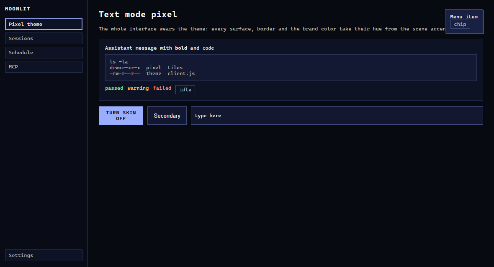
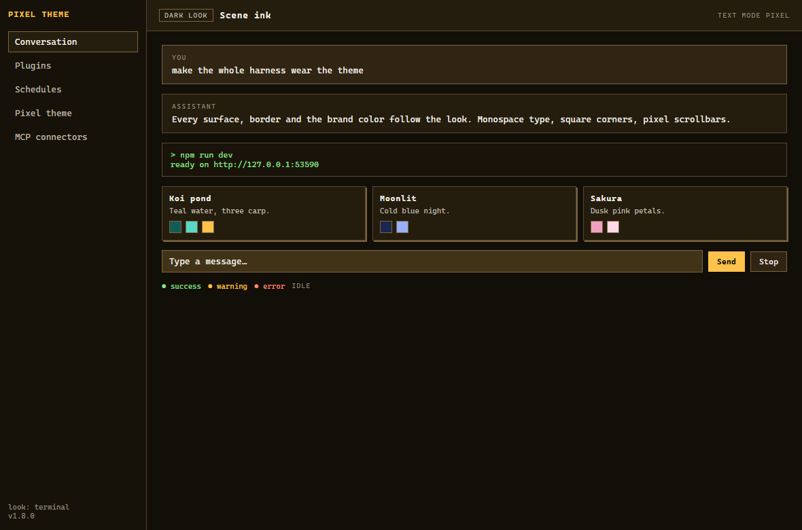
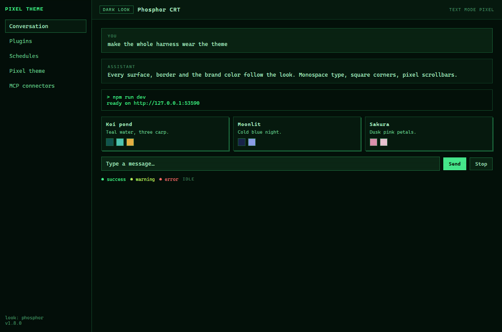
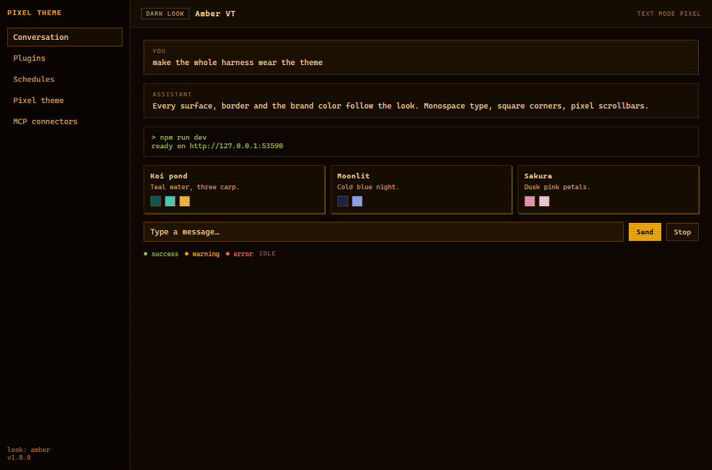
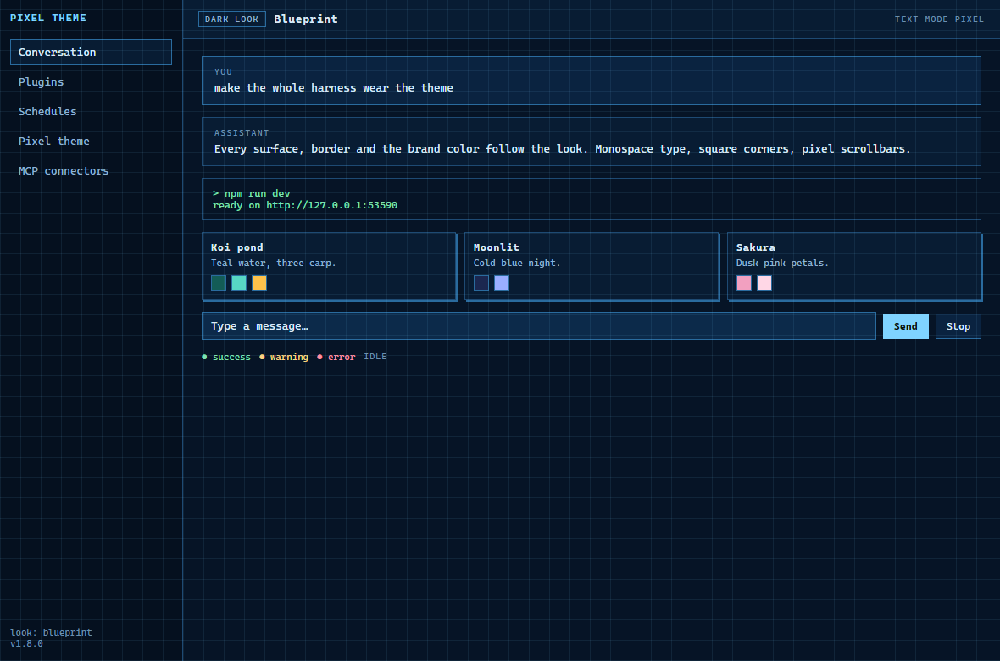
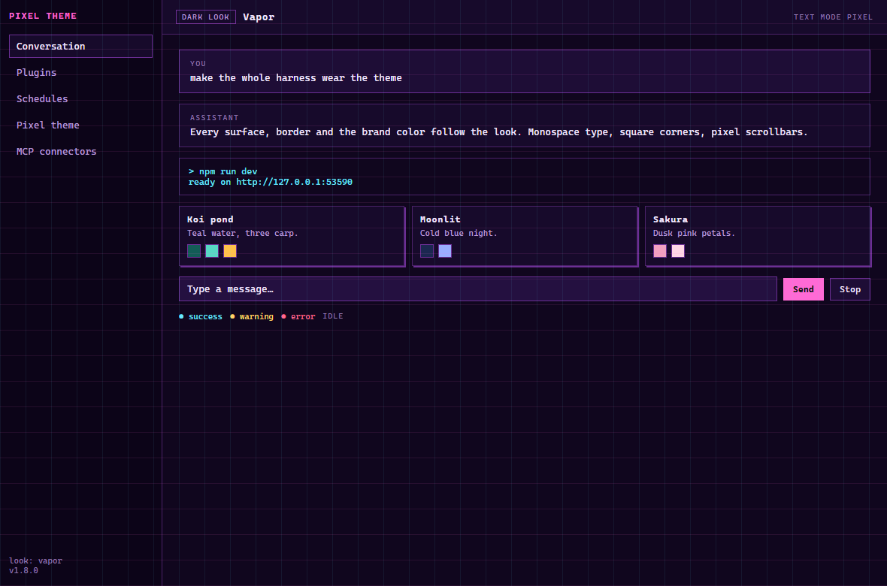
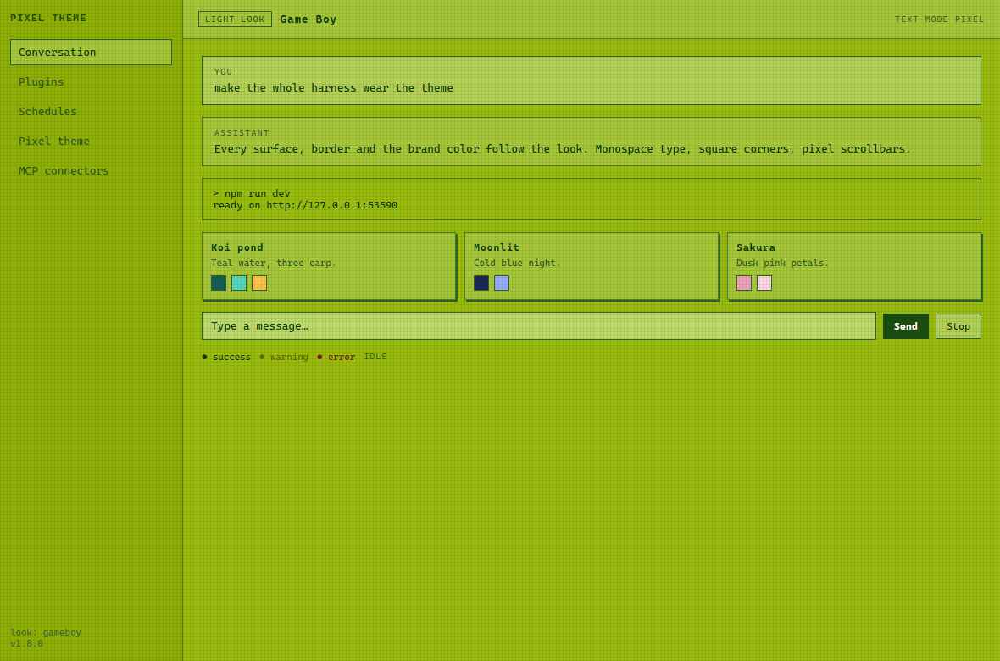

<div align="center">

# Text Mode Pixel

**A pixel-art terminal skin for the DeepSeek Harness Web UI.**
Square tiles, monospace type, and a live ASCII wallpaper — with seven looks
that paint the entire interface, from phosphor CRT green to a daylight paper
desk.

[](LICENSE)

[](https://github.com/Galaxy-VN/dsh-pixel-themes/tags)


</div>


---

## What it does

- **Paints the whole app.** Backgrounds, layers, sidebar, menus, borders,
  labels, hover states, toasts and the brand color all come from the theme —
  the Harness never falls back to its stock gray.
- **Two independent dials.** A *look* owns the palette and any CRT texture
  (scanlines, grids, glow); a *wallpaper* owns the animated ASCII scene. Any
  of the seven looks can sit under any of the thirteen scenes.
- **Color follows the scene in Scene ink.** That look derives every surface
  from the wallpaper accent; the other six bring their own fixed palette.
- **12 live ASCII wallpapers** drawn on a canvas behind the interface:
  koi pond, honu lagoon, moonlit, cloud drift, fireflies, jellyfish, lantern
  night, neon rain, sakura dusk, snow cabin, star voyage, clawd.
- **Text-mode chrome.** Monospace everywhere, ligatures off, hard 1–4 px
  shadows, square corners, 10 px pixel scrollbars.
- **No light/dark switch.** Every look is fixed and ignores the app's
  appearance preference. Paper and Game Boy are daylight looks and hide the
  wallpaper so the page stays readable.
- **Reduced motion respected** — a still frame is drawn instead of animating.

<table>
<tr>
<td width="50%"><br><sub><b>Koi pond</b> · teal</sub></td>
<td width="50%"><br><sub><b>Sakura dusk</b> · rose</sub></td>
</tr>
<tr>
<td width="50%"><br><sub><b>Moonlit</b> · periwinkle</sub></td>
<td width="50%"><br><sub><b>Auto</b> · amber</sub></td>
</tr>
</table>

> Previews are rendered from the theme's own CSS variables, so they show the
> exact palette the plugin applies. They are not screenshots of a live session.

## Looks

| Look | Palette | Texture |
| --- | --- | --- |
| Scene ink | Dyed by the scene accent | none |
| Phosphor CRT | Green phosphor on black | scanlines + text glow |
| Amber VT | Amber monochrome | scanlines |
| Blueprint | Navy drafting table, cyan ink | 24 px grid |
| Vapor | Deep purple, hot pink | 34 px neon grid |
| Paper | Daylight paper, brown ink | faint dot grain |
| Game Boy | Four DMG greens | 4 px LCD grid |

<table>
<tr>
<td width="50%"><br><sub><b>Scene ink</b></sub></td>
<td width="50%"><br><sub><b>Phosphor CRT</b></sub></td>
</tr>
<tr>
<td width="50%"><br><sub><b>Amber VT</b></sub></td>
<td width="50%"><br><sub><b>Blueprint</b></sub></td>
</tr>
<tr>
<td width="50%"><br><sub><b>Vapor</b></sub></td>
<td width="50%"><br><sub><b>Game Boy</b></sub></td>
</tr>
</table>

Paper is the seventh: the same layout on a warm daylight desk.

## Scenes

| Scene | Accent | Mood |
| --- | --- | --- |
| Auto | `#FFC24A` amber | The classic terminal look, koi pond behind it |
| Koi pond | `#57D8C4` teal | Still water, lily pads, three drifting carp |
| Honu lagoon | `#7FE3D2` mint | Turquoise reef with a slow sea turtle |
| Moonlit | `#9AAEFF` periwinkle | Navy sky, gold crescent, meteors |
| Cloud drift | `#9BB7D4` slate blue | Pale sky, cumulus banks, birds |
| Fireflies | `#E3D06A` gold | Grass, wandering lights |
| Jellyfish | `#C08CF0` violet | Deep water, waving tentacles |
| Lantern night | `#FFA45C` ember | Floating lanterns and reflections |
| Neon rain | `#6CE0FF` cyan | Rain streaks over a neon skyline |
| Sakura dusk | `#F2A0C0` rose | Falling petals, pink haze |
| Snow cabin | `#BFD9F2` frost | Falling snow, warm window |
| Star voyage | `#A98CF0` indigo | Starfield drift |
| Clawd | `#D97757` clay | The little mascot, pixel by pixel |

## Install

This directory is a Cordis plugin bundle for the Harness desktop / web profile.

```text
plugin_manager install_bundle  →  target: <absolute path to this folder>
```

Then restart or hard-refresh the Web UI (`Ctrl` + `Shift` + `R`). A **Pixel
theme** icon appears in the left sidebar rail; opening it lists every look and
scene, and the button at the bottom turns the skin off without disabling the
plugin.

The install is a junction to this working copy, so editing `client.js` and
refreshing the page is enough — no reinstall needed.

## How it works

A single client half registers two things inside one `ctx.effect`:

1. a `<style>` tag with the structural CSS (type scale, square corners, pixel
   scrollbars, hard shadows);
2. a theme layer via `ctx.theme.overrideTokens(source, tokens)`.

The token layer is **rebuilt whenever the look or, for Scene ink, the scene
accent changes**. Painted looks carry their own fixed palette; Scene ink derives
every surface and border from the accent's hue while labels stay warm off-white,
so text contrast holds on all thirteen scenes.

```js
const look = store.look;                                  // e.g. 'phosphor'
paletteOff = ctx.theme.overrideTokens(SOURCE, tokensFor(look, store.scene));
document.documentElement.style.setProperty('background-color', backgroundFor(look, store.scene));
```

Looks that draw a texture mount a single fixed `#tm-look-overlay` layer with
`pointer-events: none`; daylight looks skip the wallpaper entirely. The sidebar
page writes `{ on, look, scene }` to `localStorage` under `tm.pixel`, so the
choice survives reloads.

## Project layout

| Path | Purpose |
| --- | --- |
| `client.js` | The whole skin: tokens, CSS, ASCII scene engine, sidebar page |
| `index.js` | Host half (intentionally empty) |
| `cordis.patch.yml` | Patch row that inserts the plugin into the profile |
| `package.json` | Bundle manifest, `dsh.bundle` and `dsh.client` entries |
| `locale/en.json`, `locale/zh.json` | Plugin Manager title and description |
| `icon.svg` | Pixel monitor icon |
| `LICENSE` | MIT licence |
| `docs/preview-*.png` | Palette and look previews used by this README |

## Development

```bash
node --check client.js    # syntax
node -e "JSON.parse(require('fs').readFileSync('package.json'))"
```

Bump `version` in `package.json`, commit, tag `vX.Y.Z`, then refresh the Web UI
to see the change.

## License

MIT — see [LICENSE](LICENSE).
